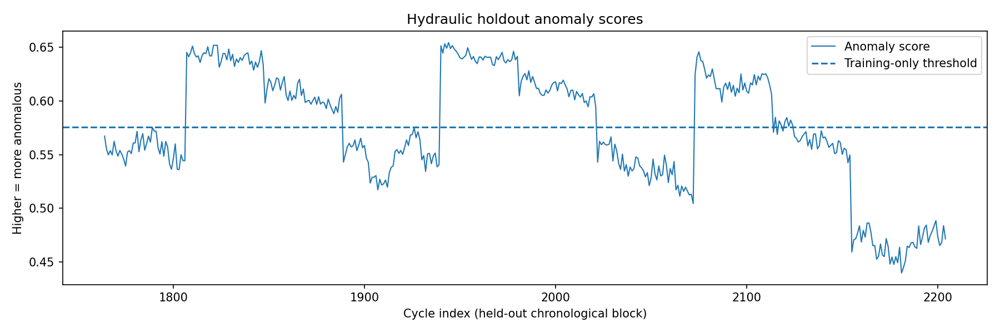
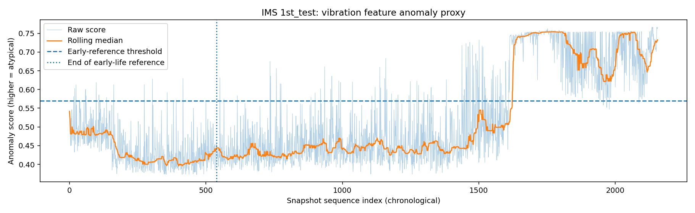
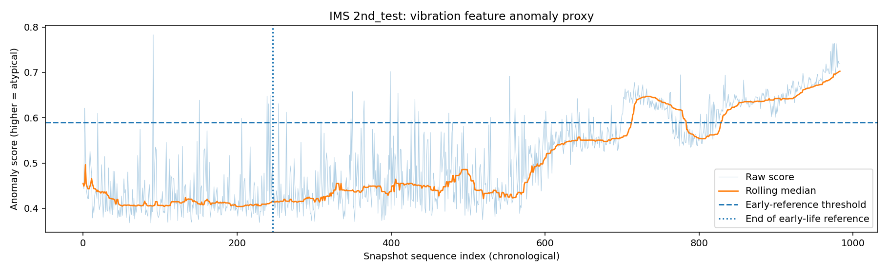
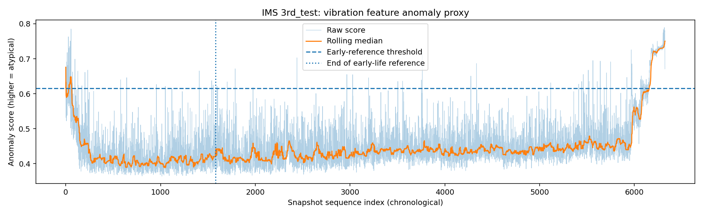
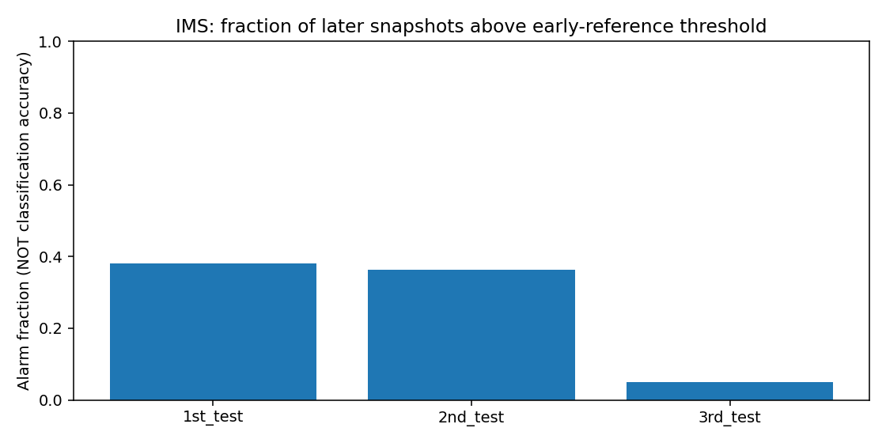

# MachineAnomaly

**Industrial Condition Intelligence · Day 25 / 100 Projects**  
**Research prototype · UCI Hydraulic + NASA/IMS Bearings · FastAPI + React**

> [!IMPORTANT]
> **Source of truth:** This repository's Kaggle notebook and saved experiment reports are the empirical evidence. MachineAnomaly predicts *hydraulic operating-condition classes* and computes *bearing vibration anomaly indicators*. It does **not** prove physical failure, estimate remaining useful life, or certify machine safety.

[Research protocol](docs/en/RESEARCH.md) · [Architecture](docs/en/ARCHITECTURE.md) · [API reference](docs/en/API.md) · [Reproduction](docs/en/REPRODUCIBILITY.md) · [Security](docs/en/SECURITY.md) · [Indonesian documentation](docs/id/README.md) · [Contributor instructions](AGENTS.md)

## 1. Project at a glance

MachineAnomaly is a reproducible educational workflow connecting two **independent** industrial-monitoring experiments to a local inference dashboard. The backend loads actual exported `.joblib` models and validates engineered feature schemas. The frontend uploads CSV data and displays predictions, classifications, timelines, and records from the API rather than fabricating inference.

| Area | Grounded current state |
|---|---|
| Domain A | UCI hydraulic condition monitoring, **2,205 cycles**, 17 sensor channels → **170 statistical features/cycle** |
| Domain B | NASA/IMS bearing degradation, **9,464 vibration snapshots** from three run-to-failure test sessions |
| Hydraulic Experiment 01 | Chronological 80/20 holdout (1,764/441), unsupervised anomaly proxy and Random Forest condition classifiers |
| Hydraulic Experiment 02 | Four target-specific stratified 60/20/20 splits; three candidate ensembles; validation macro-F1 model selection |
| IMS Experiment 01 | Independent early-reference Isolation Forest per session; **unlabeled** anomaly monitoring |
| Artifacts exposed by backend | **4 Hydraulic champions + 3 IMS anomaly models** = 7 model entries, provided local trusted artifacts exist |
| Interface | React 18, Vite 6, TypeScript; FastAPI, scikit-learn, joblib |
| Validation | 4 backend contract tests reported in original overlay; local end-to-end **Hydraulic cooler smoke test** completed with 100 rows; all seven models have **not** been individually demonstrated end-to-end |
| Deployment | Local research environment; public production deployment is **not validated** |

### Before → Now → Next

| Stage | State | Evidence / expected work |
|---|---|---|
| **Before** | Raw experimental datasets + Kaggle notebook baseline | UCI component labels; IMS timestamped vibration snapshots; Experiment 01 |
| **Now** | Reproducible research results, saved artifacts, API and dashboard | Experiment 02 metrics in `reports/experiment_02_hydraulic/heldout_final_metrics.csv`; results in `reports/`; screenshots and plots in `assets/plots/` |
| **Next** | Broader testing and hardening | Multi-class sampled smoke tests, batch upload >2,000 rows, raw-sensor preprocessing API, calibration, external/temporal evaluation, auth and deployment controls |

## 2. Evidence-first results

### Hydraulic — Experiment 02 (within-dataset stratified holdout)

Each component uses a **different target-specific** stratified random split: training 1,323, validation 441, test 441. Candidate selection uses validation macro-F1, followed by refit on training+validation and one evaluation on the untouched held-out test. These numbers are **not directly comparable as improvements** against Experiment 01's chronological holdout.

| Component | Selected model | Test accuracy | Test balanced accuracy | Test macro-F1 |
|---|---|---:|---:|---:|
| Cooler | RF balanced 240 | 1.0000 | 1.0000 | **1.0000** |
| Valve | RF balanced 240 | 0.9909 | 0.9885 | **0.9884** |
| Pump | ExtraTrees balanced 300 | 1.0000 | 1.0000 | **1.0000** |
| Accumulator | RF balanced 240 | 0.9864 | 0.9839 | **0.9841** |

**Proof:** [`heldout_final_metrics.csv`](reports/experiment_02_hydraulic/heldout_final_metrics.csv) · [`revision_history.json`](reports/experiment_02_hydraulic/revision_history.json) · target-specific prediction CSVs and confusion matrices under `reports/experiment_02_hydraulic/` and `assets/plots/experiment_02_hydraulic/` if copied from the complete Kaggle export.

### Hydraulic — Experiment 01 (chronological stress test)

| Target | Accuracy | Macro-F1 | Essential qualification |
|---|---:|---:|---|
| Cooler | 1.0000 | 1.0000 | Test partition contains **only class 100**: this is not all-class validation |
| Valve | 0.7143 | 0.6932 | Significant shift against Experiment 02 |
| Pump | 1.0000 | 1.0000 | Evaluate broader shifts before deployment |
| Accumulator | 0.1905 | 0.1650 | Poor chronological generalization |

Hydraulic Isolation Forest's **ROC-AUC = 0.5784** on a strongly imbalanced test (431 degraded / 10 healthy); **average precision = 0.9875** is inflated as an intuitive figure by the 97.7% positive prevalence and must not be promoted alone. The model used a *least-degraded stable training proxy* because only 11 jointly healthy+stable training cycles were available. See [`hydraulic_iforest_metrics.json`](reports/hydraulic_iforest_metrics.json), [`research_gate.json`](reports/research_gate.json), and [`hydraulic_anomaly_timeline.png`](assets/plots/hydraulic_anomaly_timeline.png).



### IMS — unsupervised vibration change indicators

| Test | Snapshots | Early-reference samples | Later alarm fraction | Last 10% alarm fraction |
|---|---:|---:|---:|---:|
| 1st_test | 2,156 | 539 | 0.3816 | 0.9814 |
| 2nd_test | 984 | 246 | 0.3631 | 1.0000 |
| 3rd_test | 6,324 | 1,581 | 0.0500 | 0.3370 |

**Alarm fraction is NOT classification accuracy, failure prevalence, or fault lead time.** Early-life cutoffs are test-specific. Features use the *first 4,096 rows* of each snapshot (short-window proxies), not complete signal-spectrum diagnosis. See [`ims_run_summary.csv`](reports/ims_run_summary.csv) and plots:






## 3. Data sources and provenance

| Dataset | Upstream | Scope | Permission / source note |
|---|---|---|---|
| UCI Condition Monitoring of Hydraulic Systems | https://archive.ics.uci.edu/dataset/447/condition+monitoring+of+hydraulic+systems | Sensor matrices and `profile.txt` condition labels | Dataset cited as **CC BY 4.0**; preserve attribution |
| NASA IMS Bearings | https://data.nasa.gov/dataset/ims-bearings | Timestamped bearing vibration files in 3 runs | Confirm original distributor terms for reuse; do not assert all content is under the project's code license |

Do not merge the two datasets by row or claim one general all-machine model. **No raw datasets should be committed.** The frontend consumes derived feature CSVs, not raw PS/FS signals or IMS timestamp files. `features/` in the existing working copy holds engineered samples and is **not** a raw dataset folder.

## 4. Repository layout

```text
MachineAnomaly/
├── README.md · AGENTS.md · LICENSE · .gitignore · .env.example
├── notebooks/                # Kaggle notebook and experiment notes
├── models/                   # trusted local joblib artifacts, incl experiment_02_hydraulic/
├── reports/                  # JSON/CSV evidence, audit and experiment_02_hydraulic/
├── features/                 # engineered exported feature CSVs (existing repo)
├── assets/
│   ├── plots/                # actual Kaggle plots; experiment_02_hydraulic/ as applicable
│   ├── examples/             # safe sample CSVs (no confidential industrial data)
│   ├── screenshots/          # genuine UI screenshots only
│   └── diagrams/             # actual architecture diagrams, if created
├── backend/
│   ├── README.md · AGENTS.md · requirements.txt
│   ├── app/main.py
│   ├── app/api/routes/       # health.py; predictions.py
│   ├── app/core/             # model path / CORS / upload limits
│   ├── app/inference/        # artifact registry
│   ├── app/schemas/          # validated request contracts
│   ├── app/services/         # model prediction logic
│   └── tests/                # FastAPI tests
├── frontend/
│   ├── README.md · AGENTS.md · package.json · public/
│   └── src/                  # components/ pages/ hooks/ services/ types/ styles/
├── docs/
│   ├── README.md
│   ├── id/                   # Bahasa Indonesia
│   └── en/                   # English
└── scripts/README.md
```

`features/` is an **already existing repo directory** shown by current GitHub/local layout; do not silently relocate or remove it. Never create root `datasets/` or commit downloaded ZIPs merely to make the tree look complete. Git does not track empty directories.

## 5. Local installation and launch (Windows PowerShell)

**Requirements:** Python 3.11 or compatible with installed scikit-learn model serialization, Node.js / npm, Git, and verified Kaggle `.joblib` model files. joblib/scikit-learn artifacts can be version-sensitive; match the original training environment when needed.

```powershell
# In repository root
cd "D:\porto\100 day\day 25\MachineAnomaly"

# Backend — terminal A
cd backend
python -m venv .venv
.\.venv\Scripts\Activate.ps1
python -m pip install -r requirements.txt
python -m uvicorn app.main:app --reload --port 8000

# Frontend — separate terminal B
cd "D:\porto\100 day\day 25\MachineAnomaly\frontend"
npm install
npm run dev
```

Navigate to **http://localhost:5173**; API docs: **http://localhost:8000/docs**; health: `GET /api/v1/health`; model registry: `GET /api/v1/models`. Vite development server proxies `/api` to port 8000; do not assume the proxy is deployed automatically in production.

## 6. API summary and input contracts

| Method | Endpoint | Purpose |
|---|---|---|
| GET | `/api/v1/health` | Service status; **not** a complete live readiness diagnosis |
| GET | `/api/v1/models` | Presence of 4 Hydraulic + 3 IMS artifact paths |
| POST | `/api/v1/predict/csv?kind=hydraulic&target=cooler` | Inference from 170-column Hydraulic engineered feature CSV |
| POST | `/api/v1/predict/csv?kind=ims&target=1st_test` | IMS anomaly score from model-specific feature CSV |
| POST | `/api/v1/predict/hydraulic/{target}` | JSON single-row Hydraulic request |
| POST | `/api/v1/predict/ims` | JSON single-row IMS request |

**Limits:** CSV ≤ **2,000 data rows**, upload ≤ **10 MiB**. For complete 2,205 Hydraulic cycles, split into multiple requests; automatic batching is **not implemented**. Metadata columns such as `cycle_id` and `snapshot` are dropped by the upload endpoint; arbitrary extra features trigger schema rejection. Hydraulic prediction labels are condition codes. `confidence_proxy` is an ensemble vote/probability surrogate, **not calibrated failure probability**. IMS `alarm` indicates a threshold exceedance only.

See [full API contracts](docs/en/API.md) for examples and error codes.

## 7. Reproduction, quality and testing

1. Acquire original UCI and IMS inputs from their providers; mount them in Kaggle at `/kaggle/input/datasets/wafabila/machineanomaly-dataset`, or update the notebook's `INPUT_ROOT` only.
2. Run the exported notebook from the beginning: baseline sections **00–13**, appended Experiment 02 sections **14–19** and final QA. Do not delete the initial baseline or publish expected scores as measured output.
3. Inspect `reports/dataset_provenance.csv`, `reports/research_gate.json`, experiment ledgers, holdout predictions, confusion matrices, and artifact manifest.
4. Use verified, trusted `.joblib` exports in `models/`. Run `python -m pytest -q` in `backend/` and `npm run build` in `frontend/`.
5. Smoke test a 100-row engineered Hydraulic CSV and evaluate predicted class against `profile.txt` labels **only with matching cycle IDs**. Separately test IMS model matching each test session.

Detailed [reproduction](docs/en/REPRODUCIBILITY.md) and [test matrix](docs/en/TESTING.md). Passing a code/ZIP integrity check establishes *technical reproducibility*, not generalization to real factory faults.

## 8. Limitations and claim boundaries

- **No real-time raw-sensor ingestion:** frontend uploads precomputed feature rows; no OPC-UA, PLC, MQTT or plant integration.
- **No predictive maintenance guarantee:** no validated failure-event timestamps, remaining-useful-life prediction, fault localization, maintenance action decisions or safety interlocks.
- **Hydraulic splits answer different questions:** Experiment 01 tests chronological shift (with class-support limitations); Experiment 02 tests interpolation within the same dataset and may leak nearby operating-regime similarities through random splitting.
- **IMS is unlabeled at snapshot level:** high alarm fraction may reflect drift or other experimental changes, not measured detection accuracy.
- **Prototype security:** no production authentication, authorization, rate limiting, audited artifact signing or end-to-end secure deployment.
- **No automatic batching:** 2,205-cycle complete CSV exceeds the 2,000-row request limit.
- **No metric promises:** future re-runs may vary with dependencies, environment and data packaging.

Full [limitations and research claims](docs/en/RESEARCH.md#claim-boundaries).

## 9. Roadmap

- [x] Dataset provenance and source inventory
- [x] Separate Hydraulic and IMS experiments; basic audit and evaluation artifacts
- [x] Experiment 02 model selection and export verification
- [x] Seven candidate model artifacts loaded by local backend (as seen in local dashboard)
- [x] Hydraulic cooler 100-row UI integration smoke test
- [ ] Validate all 7 API model routes end to end with matchable source labels / session metadata
- [ ] User-safe multi-batch CSV uploads, cancellation, progress, and CSV export
- [ ] Generalization study: grouped temporal/operating-regime splits and external hardware validation
- [ ] Calibrated probabilities and explicit unknown/out-of-distribution policies
- [ ] Version-pinned model manifest, signing, dependency lockfiles, CI
- [ ] Authentication, authorization, rate limits, stricter CSV threat controls
- [ ] Containerization, observability, privacy review and production threat model

## 10. Troubleshooting / FAQ

**Why does uploading `hydraulic_cycle_features.csv` show "Maximum 2000 rows per request"?** 2,205 cycles exceed the API row cap. Export ≤2,000 rows at once; do not misinterpret HTTP 413 as model failure. [Troubleshooting](docs/en/TROUBLESHOOTING.md).

**Why are the first 100 cooler predictions all class 3?** The first part of UCI profile has cooler class 3. A same-class batch tests connectivity, not performance across all conditions.

**Does `7/7 ready` mean accuracy is proven?** No; model registry checks local artifact existence. It does not run representative predictions, verify ground truth, or establish deployment fitness.

**Why do IMS alarms not equal failure events?** Session-level run-to-failure context exists, but no verified per-snapshot fault labels were supplied for this notebook.

**Can I upload original raw sensor files?** No; current models require the exact engineered schemas. See [API](docs/en/API.md).

**Can this be used commercially?** The repository's code license and upstream dataset licenses are separate. Confirm each dataset's permissions and the trustworthiness of serialized model artifacts before any commercial use.

## 11. License, security, acknowledgments

**Code license:** see [`LICENSE`](LICENSE). **Do not infer its terms from the README** if that file has not yet been populated or reviewed. UCI data is attributed to its original authors/provider under CC BY 4.0; NASA/IMS redistribution must follow the source terms. `models/*.joblib` are pickle-based: **never unpickle untrusted model files**. Avoid committing data from real plants, API tokens, `.env` credentials, caches or huge archives. See [security policy](docs/en/SECURITY.md).

Dataset and research authors retain their own rights. This independent educational implementation makes no affiliation or endorsement claim. Evidence should be reproduced and attributed using upstream source URLs and the locally saved Kaggle experiment reports.
